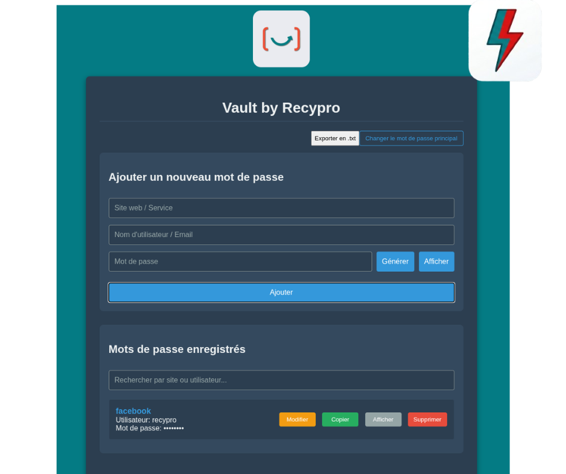

# Vault by Recypro

Gestionnaire de mots de passe chiffré (AES-256-GCM) par Recypro.

## Téléchargement

Les versions compilées sont disponibles dans la section **Releases** :

<https://github.com/papyrus448/Vault-by-Recypro/releases/latest>

| Plateforme | Fichier |
|---|---|
| Windows (portable, sans installation) | `Vault-by-Recypro-<version>-portable.exe` |
| Linux (AppImage) | `Vault-by-Recypro-<version>-x86_64.AppImage` |

## Documentation

- **Guide Windows (installation, raccourci Bureau, utilisation)** : [GUIDE-WINDOWS.md](GUIDE-WINDOWS.md)
- **Notes techniques Windows** : [Vault by Recypro (windows)/README-WINDOWS.md](Vault%20by%20Recypro%20(windows)/README-WINDOWS.md)
- **Notes techniques Linux** : [Vault by Recypro (linux)/README-LINUX.md](Vault%20by%20Recypro%20(linux)/README-LINUX.md)

## Structure du dépôt

```text
Vault by Recypro (windows)/   Code source et configuration Electron pour Windows
Vault by Recypro (linux)/     Code source et configuration Electron pour Linux
GUIDE-WINDOWS.md              Guide utilisateur Windows
```

## Données

Les mots de passe sont stockés **uniquement sur la machine de l'utilisateur**, chiffrés avec une clé dérivée du mot de passe principal :

- Windows : `%APPDATA%\Vault by Recypro\`
- Linux : `~/.config/Vault by Recypro/`

Le mot de passe principal n'est stocké nulle part. En cas d'oubli, les données sont irrécupérables.
